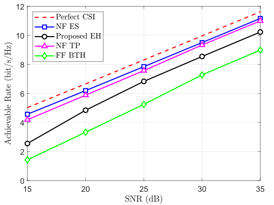

# Unofficial Implementation of Efficient Hierarchical Beam Training for Extremely Large-Scale MIMO

This repository provides an independent MATLAB implementation of the beam training method proposed in the paper **"Efficient Hierarchical Beam Training for Extremely Large-Scale MIMO: From Far-Field to Near-Field"**.

The implementation is based on the published methodology and is intended for academic research and reproducibility purposes.

### Reference

J. Dai et al., "Efficient Hierarchical Beam Training for Extremely Large-Scale MIMO: From Far-Field to Near-Field," *IEEE Trans. Veh. Technol.*, early access, Aug. 2026, doi: 10.1109/TVT.2026.3727316.

**Paper:** https://ieeexplore.ieee.org/abstract/document/11665551

### Disclaimer

This is an unofficial implementation. All credit for the original algorithm and theoretical contributions belongs to the authors of the referenced paper.

